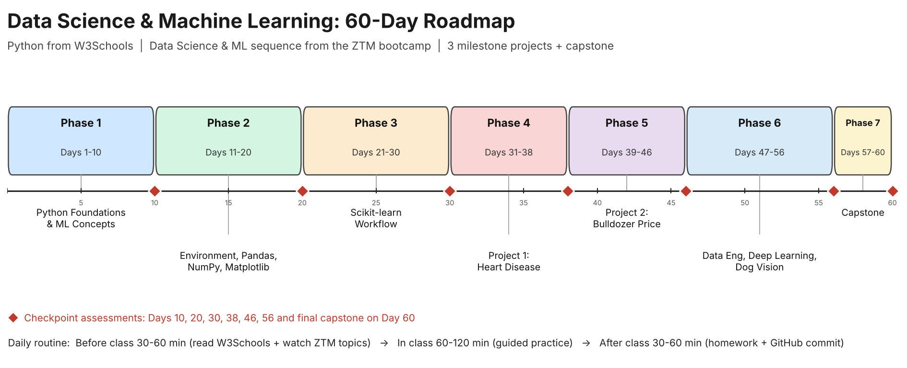

# Data Science and Machine Learning: 60-Day Curriculum

A structured 60-day learning plan for students, interns and mentees who are learning **AI, Data Science and Machine Learning** with a tutor.

- **Python** is learnt from [W3Schools](https://www.w3schools.com/python/). Every day lists the exact pages to read (clickable).
- **Data Science and Machine Learning** follows the sequence of the [Zero To Mastery (ZTM) Complete A.I. Machine Learning and Data Science bootcamp](https://zerotomastery.io/courses/machine-learning-and-data-science-bootcamp/). Each day lists only the **topics and ideas** to watch in the student's own copy of the course.
- **Projects** follow ZTM's three milestone projects: Heart Disease classification, Bulldozer price regression and Dog Vision image classification, followed by a capstone.

> This is an independently developed teaching plan. It is not affiliated with or endorsed by Zero To Mastery or W3Schools. This repository contains no ZTM videos, notebooks or datasets; students need their own access to the course.



See the full [ROADMAP](ROADMAP.md) for the visual map and week-by-week plan.

## The 7 phases

| # | Phase | Days | Length |
| --- | --- | --- | --- |
| 1 | [Python Foundations & ML Concepts](curriculum/phase-1-python-foundations-ml-concepts.md) | 1-10 | 10 |
| 2 | [Data Science Tools: Environment, Pandas, NumPy, Matplotlib](curriculum/phase-2-data-tools.md) | 11-20 | 10 |
| 3 | [Scikit-learn: Building ML Models](curriculum/phase-3-scikit-learn-workflow.md) | 21-30 | 10 |
| 4 | [Milestone Project 1: Heart Disease Classification](curriculum/phase-4-project-1-classification.md) | 31-38 | 8 |
| 5 | [Milestone Project 2: Bulldozer Price Regression](curriculum/phase-5-project-2-regression.md) | 39-46 | 8 |
| 6 | [Data Engineering, Deep Learning & Dog Vision](curriculum/phase-6-data-engineering-deep-learning.md) | 47-56 | 10 |
| 7 | [Communication, Portfolio & Capstone](curriculum/phase-7-communication-portfolio-capstone.md) | 57-60 | 4 |

## Daily routine

| When | Time | What happens |
| --- | --- | --- |
| Before class | 30-60 min | Read the listed W3Schools pages and watch the listed ZTM topics. Write down questions. |
| In class | 60-120 min | Tutor and student review, code together and solve a practical exercise. The student explains decisions aloud. |
| After class | 30-60 min | Finish the homework, fix errors, commit to GitHub and tick [PROGRESS.md](PROGRESS.md). |

## Assessments

| Day | Checkpoint |
| --- | --- |
| 10 | [Checkpoint 1: Python Basics & ML Concepts](assessments/checkpoint-1-python-ml-concepts.md) |
| 20 | [Checkpoint 2: Pandas, NumPy & Matplotlib](assessments/checkpoint-2-data-tools.md) |
| 30 | [Checkpoint 3: Scikit-learn Workflow](assessments/checkpoint-3-scikit-learn.md) |
| 38 | [Checkpoint 4: Heart Disease Project](assessments/checkpoint-4-heart-disease-project.md) |
| 46 | [Checkpoint 5: Bulldozer Project](assessments/checkpoint-5-bulldozer-project.md) |
| 56 | [Checkpoint 6: Dog Vision Project](assessments/checkpoint-6-dog-vision-project.md) |
| 60 | [Final: Capstone Presentation](assessments/final-capstone.md) |

## Repository structure

```
data-science-machine-learning-curriculum/
├── README.md
├── ROADMAP.md              # visual roadmap and week-by-week plan
├── PROGRESS.md             # student progress tracker (copy per student)
├── curriculum/             # one file per phase
├── daily-lessons/          # day-01.md ... day-60.md
├── exercises/              # student work is saved here
├── projects/               # project briefs (3 milestone projects + capstone)
├── assessments/            # 6 checkpoints + final rubric
├── templates/              # daily reflection and README templates
└── docs/roadmap.png
```

## How to use this repo

1. **Tutor:** fork or clone this repo. Share it with each student (or give each student their own copy).
2. **Student:** make your own repo from this one. Keep your exercises in `exercises/` and tick days off in `PROGRESS.md`.
3. **Each day:** open `daily-lessons/day-XX.md` and follow Before, Class, After.
4. **Pace:** this is a 60-learning-day plan, not 60 calendar days. If a topic is hard, repeat the day. Many learners will take 3 months because ZTM itself is about 45 hours of video.

## Notes for the tutor

- The ZTM column lists topics and ideas, not exact lecture titles. Match each day to the lectures in your copy of the course; the order of the sections follows the ZTM course page.
- Use Google Colab for deep learning days if the student's laptop has no GPU.
- Heart disease is a learning exercise. Students must never present the model as a medical diagnostic tool.
- The bulldozer dataset is time-related regression, not a classic forecasting task. Teach chronological validation to avoid leaking the future.
- Python is taught alongside the data work, so students reach real data by Day 13 instead of finishing all Python first.

## Credits

Curriculum plan by Samuel Yaula Dutse. Python learning resources: [W3Schools](https://www.w3schools.com/python/). Data science and ML content: Zero To Mastery (Andrei Neagoie and Daniel Bourke), accessed by learners through their own course access.
