# 60-Day Roadmap

## Learning path

```mermaid
flowchart TD
    START([Start: Day 1]) --> P1
    P1["Phase 1<br/>Python Foundations<br/>and ML Concepts<br/>Days 1-10"]
    P2["Phase 2<br/>Environment, Pandas,<br/>NumPy, Matplotlib<br/>Days 11-20"]
    P3["Phase 3<br/>Scikit-learn Workflow<br/>Days 21-30"]
    P4["Phase 4<br/>Project 1: Heart Disease<br/>Classification<br/>Days 31-38"]
    P5["Phase 5<br/>Project 2: Bulldozer<br/>Price Regression<br/>Days 39-46"]
    P6["Phase 6<br/>Data Engineering, Deep<br/>Learning, Dog Vision<br/>Days 47-56"]
    P7["Phase 7<br/>Communication, Portfolio<br/>and Capstone<br/>Days 57-60"]
    C1{{"Checkpoint 1<br/>Day 10"}}
    C2{{"Checkpoint 2<br/>Day 20"}}
    C3{{"Checkpoint 3<br/>Day 30"}}
    C4{{"Checkpoint 4<br/>Day 38"}}
    C5{{"Checkpoint 5<br/>Day 46"}}
    C6{{"Checkpoint 6<br/>Day 56"}}
    FIN{{"Final capstone<br/>Day 60"}}
    P1 --> C1
    C1 --> P2
    P2 --> C2
    C2 --> P3
    P3 --> C3
    C3 --> P4
    P4 --> C4
    C4 --> P5
    P5 --> C5
    C5 --> P6
    P6 --> C6
    C6 --> P7
    P7 --> FIN
    FIN --> END([Graduate: portfolio of 4 projects])
    style P1 fill:#cfe8ff,stroke:#555,color:#000
    style P2 fill:#d5f5e3,stroke:#555,color:#000
    style P3 fill:#fdebd0,stroke:#555,color:#000
    style P4 fill:#f9d6d5,stroke:#555,color:#000
    style P5 fill:#e8daef,stroke:#555,color:#000
    style P6 fill:#d6eaf8,stroke:#555,color:#000
    style P7 fill:#fcf3cf,stroke:#555,color:#000
```

## What you can do after each phase

| After | You can |
| --- | --- |
| Phase 1 (Day 10) | Write basic Python programs and explain the six-step ML framework |
| Phase 2 (Day 20) | Set up an environment, clean data with pandas, use NumPy arrays and make charts |
| Phase 3 (Day 30) | Run the full Scikit-learn workflow: prepare, model, evaluate, tune and save |
| Phase 4 (Day 38) | Deliver a complete classification project |
| Phase 5 (Day 46) | Deliver a regression project with time-based data |
| Phase 6 (Day 56) | Explain data pipelines and build an image classifier with transfer learning |
| Phase 7 (Day 60) | Present a capstone project and explain results to non-technical people |

## Week by week (7 learning days per week)

| Week | Days | Phase focus | Checkpoints |
| --- | --- | --- | --- |
| 1 | 1-7 | Python Foundations & ML Concepts | - |
| 2 | 8-14 | Python Foundations & ML Concepts; Data Science Tools: Environment, Pandas, NumPy, Matplotlib | Checkpoint 1 |
| 3 | 15-21 | Data Science Tools: Environment, Pandas, NumPy, Matplotlib; Scikit-learn: Building ML Models | Checkpoint 2 |
| 4 | 22-28 | Scikit-learn: Building ML Models | - |
| 5 | 29-35 | Scikit-learn: Building ML Models; Milestone Project 1: Heart Disease Classification | Checkpoint 3 |
| 6 | 36-42 | Milestone Project 1: Heart Disease Classification; Milestone Project 2: Bulldozer Price Regression | Checkpoint 4 |
| 7 | 43-49 | Milestone Project 2: Bulldozer Price Regression; Data Engineering, Deep Learning & Dog Vision | Checkpoint 5 |
| 8 | 50-56 | Data Engineering, Deep Learning & Dog Vision | Checkpoint 6 |
| 9 | 57-60 | Communication, Portfolio & Capstone | Final |

## Python (W3Schools) coverage map

| Python area | Days |
| --- | --- |
| Core Python: syntax, variables, types, strings, operators | 1-6 |
| Collections: lists, tuples, dictionaries, sets | 7-8 |
| Control flow and functions | 9-10 |
| Modules, packages, files, errors | 11-12 |
| Pandas | 13-15, 31-46 |
| NumPy | 16-18, 49, 52 |
| Matplotlib | 19-20, 33, 37, 54, 56-57 |
| W3Schools ML tutorial pages (as a gentle companion to Scikit-learn) | 21-38 |
| Classes and objects (needed to understand sklearn and Keras models) | 21, 43, 48, 53 |

[Back to README](README.md)
